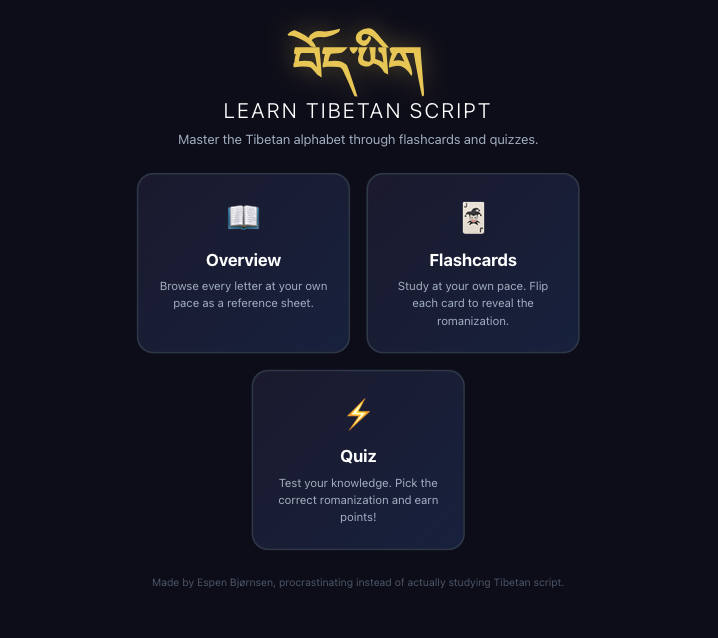

# Learning Tibetan?
This little web-app is a work in progress. A small tool for now, but might grow into a bigger tool box for anyone who wants to learn Tibetan / Dzongkha

Try it out here: https://schpenn.github.io/tibetan/
 

## Tibetan reference set

The app teaches **Uchen (dbu-can), upright headed print forms**, not cursive
Ume, calligraphy, or stroke order. This is a prototype style choice pending
review by someone knowledgeable in Tibetan writing.

All 30 consonants are explicitly mapped by their `alphabet.ts` IDs in
[drawingReferences.ts](src/data/drawingReferences.ts), including the distinct
IDs `"'a"` and `"a"`. Regular (400) and semibold (600) variants come from the
same bundled Noto Serif Tibetan variable font. Teaching cards, quiz glyphs,
and letters-to-review feedback use the regular reference through
`TibetanGlyph`; a future evaluator should use `getDrawingReference` rather
than system fonts or guessed filenames. Vowels use the bundled font too,
but are outside the consonant reference manifest.

Source revision, checksum, style, limitations, and attribution are recorded
[alongside the font](src/assets/references/provenance.json). The unmodified
font is Copyright 2022 The Noto Project Authors and redistributed under
[SIL OFL 1.1](src/assets/references/OFL.txt). Keep the copyright notice and
license with redistributions; the app links to the bundled license.

**These are font-rendered prototypes, not validated handwriting references.**
Two weights do not constitute two reviewed handwriting examples. Scored
drawing recognition is not implemented and must remain blocked until all
30 consonants have licensed, reviewed reference coverage and the quality
gate in [DRAWING-QUIZ-PLAN.md](DRAWING-QUIZ-PLAN.md) is met.

## Fixture status and voluntary intake

[drawingFixtures.ts](src/data/drawingFixtures.ts) contains 22 original,
CC0-1.0 synthetic rendering recipes with calibration and held-out partitions.
They cover prototype acceptable shapes, candidate confusion pairs (`ka/kha`,
`pa/pha`, `tsa/tsha`, and `a/'a`), missing/extra ink, scribbles, tiny marks,
and blanks. Their labels describe construction intent only, not linguistic
review. Render onto the specified 256×256 canvas, loading the manifest font
with the specified weight before drawing text, then applying erasures and
stroke polylines in the documented order. Font rasterization can vary across
browsers; record browser/version when using these smoke fixtures.

**The human fixture set is empty.** No writer consent, expert approval,
real input-device samples, or handwriting performance is claimed. These
synthetic partitions share a font source and must not be used as evidence
of held-out handwriting accuracy or to tune production scoring.

Before adding human fixtures or handwriting references:

1. Recruit volunteers separately from gameplay. Obtain explicit permission
   to publish the drawing, its labels, and pseudonymous writer metadata.
   Obtain a separate CC0-1.0 dedication or CC-BY-4.0 license grant;
   participation consent alone is not a license. Keep original consent
   records privately, and commit only non-sensitive audit record IDs and
   agreed public attribution. Do not commit signatures or contact details.
2. Record provenance for each asset: source, license, attribution, consent
   and license record IDs, stable target/drawn consonant IDs, actual input
   method, logical canvas size, brush width, and ink-only strokes. The
   `HumanDrawingFixture` type defines required fields; references likewise
   need source/license and reviewer evidence alongside their assets.
3. Have a knowledgeable Tibetan reviewer label every sample and approve
   reference examples. Record reviewer ID, review date, and rationale,
   especially for ambiguous or easily confused forms. Obtain multiple
   independent approved references per consonant where possible.
4. Assign each writer to **one split only**, before calibration; never put
   the same writer or derivatives of the same sample in both splits.
   Reserve held-out writers for the final evaluation, not threshold tuning.
5. Obtain acceptable beginner examples and wrong/missing/extra-stroke,
   scribble, tiny-mark, and blank cases across mouse, touch, and stylus.
   Expand reviewed coverage beyond the prototype confusion pairs and
   record sample counts and gaps per consonant/device before release.

No user drawings are automatically collected. The app has no drawing
capture, upload, storage, analytics, or fixture-ingestion path. Future
drawing input must remain local and ephemeral; voluntary fixture intake
must remain a separate, explicit process, never a gameplay side effect.
